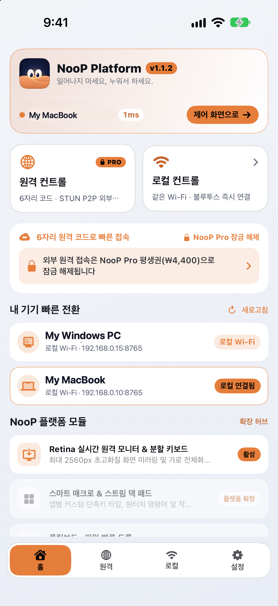
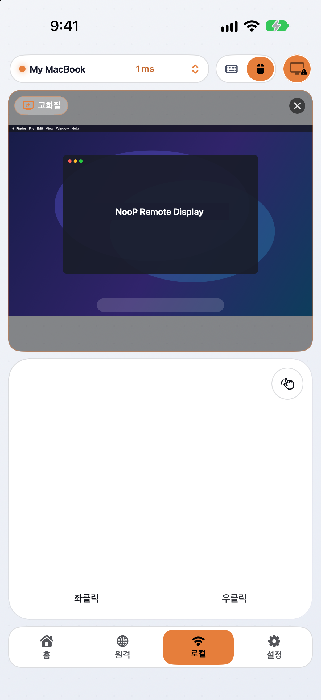
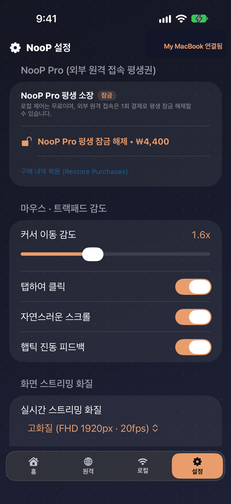
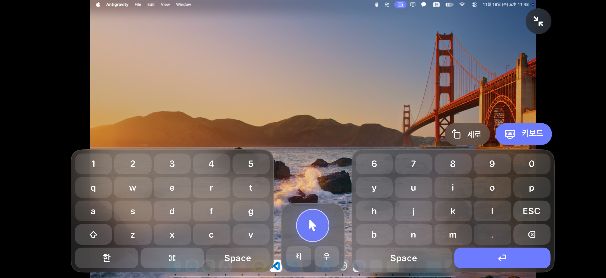

<h1>
  
  &nbsp;NooP
</h1>

> **일어나지 마세요, 누워서 하세요. NooP.**

iPhone을 **무선 마우스 · 키보드 · 원격 미니 모니터**로 사용하는 경량 로컬 + 원격 제어 앱입니다.  
같은 Wi-Fi에서는 자동으로 초고속 연결되며, Wi-Fi가 없을 때는 **Bluetooth LE**, 외부(LTE/5G/외부 Wi-Fi)에서는 별도 VPN이나 공유기 포트포워딩 없이 **6자리 원격 코드(STUN + UDP P2P 홀펀칭 / 내장 클라우드 릴레이)**로 즉시 연결됩니다.

| 홈 허브 (`홈`) | 원격 접속 (`원격`) | 화면 공유 · 키보드 (`로컬`) | 트랙패드 (`마우스`) |
| :---: | :---: | :---: | :---: |
|  |  |  |  |

| 설정 & `NooP Pro` (`설정`) | 데스크톱 에이전트 (`NooP` Mac / Windows) |
| :---: | :---: |
|  |  |

### 가로 전체화면 & 양손 분할 키보드

  

---

> **다운로드 (Releases v1.1.1)**: [최신 버전 다운로드 바로가기](https://github.com/sungomi/NooP/releases/latest)  
> - **Mac (`NooP`)**: `NooP.dmg`  
> - **Windows (`NooP for pc`)**: `NooP-Setup.exe` *(Windows 10/11 64비트용 설치 파일)*  
> - **iPhone (`NooP`)**: **App Store 출시 예정** *(Coming Soon)*

---

## 주요 기능

- **4-카테고리 통합 워크스페이스 (`홈 | 원격 | 로컬 | 설정`)**
  - **홈 탭**: 내 기기 빠른 전환 · 6자리 원격 코드 연결 · 확장 플랫폼 모듈 허브
  - **원격 탭 (`NooP Pro`)**: 별도 프로그램이나 공유기 설정 없이 Mac / PC용 `NooP` 앱에 표시된 **6자리 원격 연결 코드**를 한 번 등록하면 STUN + UDP 홀펀칭 P2P(및 내장 릴레이)로 외부 LTE/5G에서도 자동 연결
  - **로컬 탭**: 같은 Wi-Fi(Bonjour · UDP 자동 검색) 또는 Bluetooth LE로 지연 없이 즉시 연결
  - **설정 탭**: 커서 감도, 탭하여 클릭, 자연스러운 스크롤, 햅틱, 스트리밍 화질, 등록된 기기 관리 및 `NooP Pro` 관리
- **키보드 모드 우선 & 즉시 마우스 제어**
  - 영문 QWERTY · 한글 두벌식(쌍자음/조합 지원) · 기호 · `F1~F12` · `⌘C/⌘V/⌘Z/⌘A/⌘W` · `⌘Space` · 미디어 컨트롤
  - 중앙의 **커서 핸들**을 드래그하면 화면 전환 없이 바로 마우스를 움직이고, 양옆 `좌` / `우` 버튼으로 즉시 클릭 가능
- **트랙패드(마우스) 모드**
  - 한 손가락 이동(속도 기반 가속), 탭 좌클릭, 두 손가락 스크롤 & 탭 우클릭
  - 우측 상단 **제스처 모드** 버튼 활성화 시 한 손가락 스와이프(Mission Control / 데스크톱 공간 전환) 및 핀치 줌 지원
- **Retina 고화질 원격 화면 공유 & 전체화면 분할 키보드**
  - 상단 모니터 버튼을 누르면 Mac/PC 화면을 실시간으로 보면서 조작 가능 (`초고화질 2560px` / `고화질 2200px` / `균형 1600px` / `절약 1280px` 실시간 전환)
  - 화면을 터치해 우측 하단 **전체화면** 버튼을 누르면 가로 전체화면으로 전환되며, 우측 `키보드` 버튼으로 **양손 분할(Split) 플로팅 키보드** 사용 가능

---

## 설치 방법

### 1. Mac / Windows 데스크톱 에이전트 설치하기
1. [Releases](https://github.com/sungomi/NooP/releases/latest)에서 OS에 맞는 파일(**`NooP.dmg`** 또는 **`NooP-Setup.exe`**)을 다운로드합니다.
2. **Mac 기준 (`NooP`)**:
   - `NooP.app`을 **`Applications(응용 프로그램)`** 폴더로 드래그합니다.
   - 처음 실행 시에는 **앱 아이콘 오른쪽 클릭 → `열기`**를 누릅니다. *(안 열리면 `시스템 설정` → `개인정보 보호 및 보안` → `확인 없이 열기`)*
   - 실행 후 **`손쉬운 사용`** 권한을 켜줍니다. *(화면 공유는 `화면 및 시스템 오디오 녹음` 권한도 허용)*
3. **Windows 기준 (`NooP for pc`)**:
   - **`NooP-Setup.exe`**를 실행하여 설치를 진행합니다. *(설치 과정에서 Windows 방화벽 허용 규칙이 자동으로 등록됩니다.)*
4. **외부 원격 접속**:
   - 데스크톱 앱 좌측 **`원격 접속`** 탭에 표시된 **6자리 숫자 코드**를 iPhone `NooP` 앱의 **`원격`** 탭에 입력하면 어디서나 바로 연결됩니다.

### 2. iPhone 앱 (`NooP`) 설치하기
- **App Store 출시 예정**입니다.
- 출시 후 앱을 설치하고 실행하면 **`로컬 네트워크`** 및 **`블루투스`** 권한을 허용한 뒤 로컬 또는 6자리 원격 코드로 바로 연결할 수 있습니다.

---

## 제작자

**sungomi** · [github.com/sungomi](https://github.com/sungomi)

© 2026 sungomi. All rights reserved. 자세한 내용은 [LICENSE](LICENSE)를 보세요.
