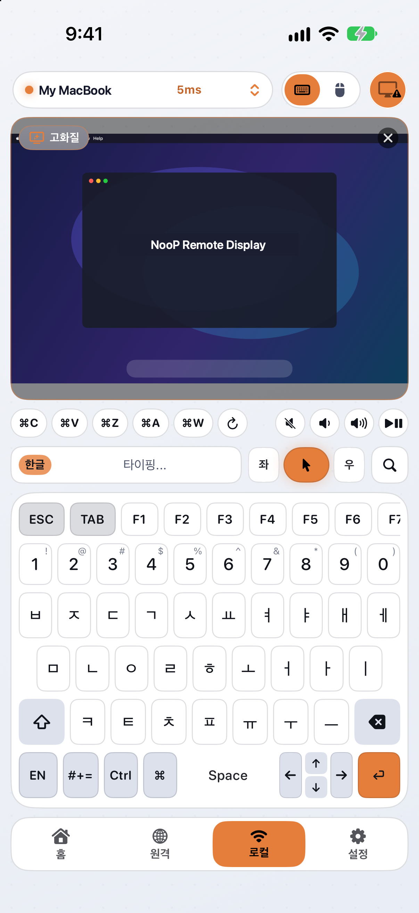
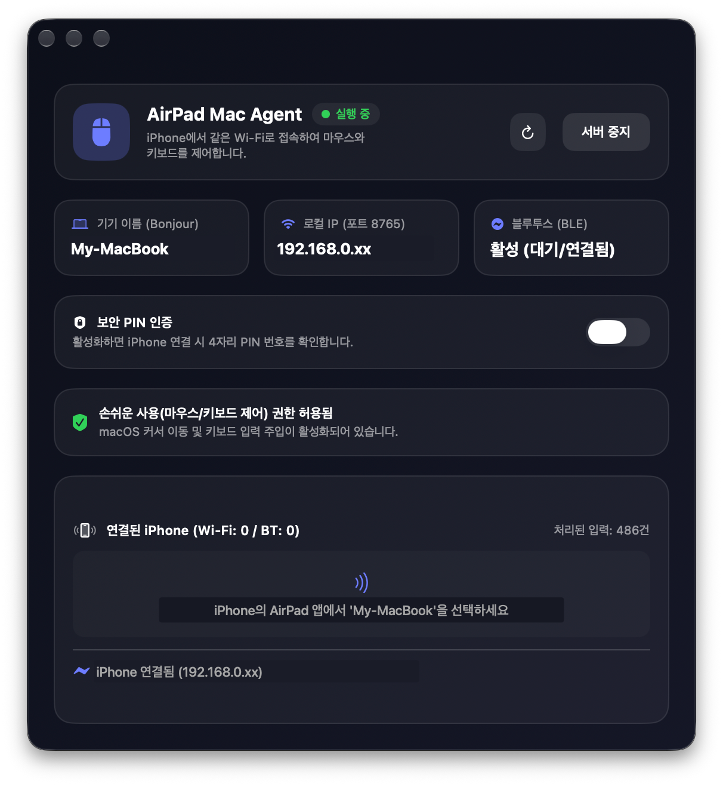

# NooP (구 TouchDeck)

iPhone을 **무선 마우스 · 키보드 · 원격 미니 모니터**로 사용하는 경량 로컬 + 원격 제어 앱입니다.  
같은 Wi-Fi에서는 자동으로 초고속 연결되며, Wi-Fi가 없을 때는 **Bluetooth LE**, 외부(LTE/5G/외부 Wi-Fi)에서는 별도 중계 서버 없이 **TLS(`wss://`) 원격 접속**을 지원합니다.

| 원격 화면 연결 (키보드 모드) | 트랙패드 (마우스 모드) | 데스크톱 에이전트 (Windows / macOS) |
| :---: | :---: | :---: |
|  |  |  |

### 가로 전체화면 & 양손 분할 키보드
<p align="center">
  
</p>

---

> **다운로드 (Releases v1.1)**: [최신 버전 다운로드 바로가기](https://github.com/sungomi/TouchDeck/releases/latest)  
> - **Mac (`NooPMac`)**: `NooPMac.dmg`  
> - **Windows (`NooP for pc`)**: `NooP-Setup.exe` *(Windows 10/11 64비트용 설치 파일)*  
> - **iPhone (`NooP`)**: **App Store 출시 예정** *(Coming Soon)*

---

## 주요 기능

- **키보드 모드 우선 & 즉시 마우스 제어**
  - 영문 QWERTY · 한글 두벌식(쌍자음/조합 지원) · 기호 · `F1~F12` · `⌘C/⌘V/⌘Z/⌘A/⌘W` · `⌘Space` · 미디어 컨트롤
  - 중앙의 **커서 핸들**을 드래그하면 화면 전환 없이 바로 마우스를 움직이고, 양옆 `좌` / `우` 버튼으로 즉시 클릭 가능
- **트랙패드(마우스) 모드**
  - 한 손가락 이동(속도 기반 가속), 탭 좌클릭, 두 손가락 스크롤 & 탭 우클릭
  - 우측 상단 **제스처 모드** 버튼 활성화 시 한 손가락 스와이프(Mission Control / 데스크톱 공간 전환) 및 핀치 줌 지원
- **실시간 원격 화면 공유 & 전체화면 분할 키보드**
  - 상단 모니터 버튼(또는 `화면 연결`)을 누르면 Mac/PC 화면을 실시간으로 보면서 조작 가능
  - 화면을 터치해 우측 하단 **전체화면** 버튼을 누르면 가로 전체화면으로 전환되며, 상단 `키보드` 버튼으로 **양손 분할(Split) 플로팅 키보드** 사용 가능
- **Wi-Fi + Bluetooth LE 하이브리드 & 저전력 설계**
  - 한 번 연결해 두면 앱을 켤 때마다 자동 재연결, 백그라운드 전환 시 소켓·스캔 중단으로 배터리 소모 최소화

---

## 설치 방법

### 1. Mac / Windows 데스크톱 에이전트 설치하기
1. [Releases](https://github.com/sungomi/TouchDeck/releases/latest)에서 OS에 맞는 파일(**`TouchDeckMac.dmg`** 또는 **`TouchDeckPC-Setup.exe`**)을 다운로드합니다.
2. **Mac 기준**:
   - `TouchDeck Mac.app`을 **`Applications(응용 프로그램)`** 폴더로 드래그합니다.
   - 처음 실행 시에는 **앱 아이콘 오른쪽 클릭 → `열기`**를 누릅니다. *(안 열리면 `시스템 설정` → `개인정보 보호 및 보안` → `확인 없이 열기`)*
   - 실행 후 **`손쉬운 사용`** 권한을 켜줍니다. *(화면 공유는 `화면 및 시스템 오디오 녹음` 권한도 허용)*
3. **Windows 기준**:
   - **`TouchDeckPC-Setup.exe`**를 실행하여 설치를 진행합니다. *(설치 과정에서 Windows 방화벽 허용 규칙이 자동으로 등록됩니다.)*
4. Wi-Fi를 변경했을 때는 상단 **`↻` 새로고침 버튼**을 누르면 새 IP로 즉시 갱신되며, **로그인 시 자동 실행** 토글도 지원합니다.

### 2. iPhone 앱 (`TouchDeck`) 설치하기
- **App Store 출시 예정**입니다.
- 출시 후 앱을 설치하고 실행하면 **`로컬 네트워크`** 및 **`블루투스`** 권한을 허용한 뒤 같은 Wi-Fi 또는 블루투스로 바로 연결할 수 있습니다.

## 다운로드한 파일 확인하기 (선택)

릴리스마다 `SHA256SUMS`(파일 지문표)와 `SHA256SUMS.sig`(sungomi의 서명)가 함께 올라갑니다.
받은 파일의 지문을 아래 명령으로 확인하고, `SHA256SUMS`에 적힌 값과 같으면 원본 그대로입니다.

- Mac: `shasum -a 256 받은파일이름`
- Windows (명령 프롬프트): `certutil -hashfile 받은파일이름 SHA256`

서명까지 확인하려면 (Mac/Linux):

```bash
echo "353765157+sungomi@users.noreply.github.com $(curl -s https://api.github.com/users/sungomi/ssh_signing_keys | python3 -c "import sys,json;print(json.load(sys.stdin)[0][\"key\"])")" > sungomi_signers
ssh-keygen -Y verify -f sungomi_signers -I 353765157+sungomi@users.noreply.github.com -n file -s SHA256SUMS.sig < SHA256SUMS
```

`Good "file" signature`가 나오면 sungomi가 서명한 지문표입니다.

---

## 제작자

**sungomi** · [github.com/sungomi](https://github.com/sungomi)

© 2026 sungomi. All rights reserved. 자세한 내용은 [LICENSE](LICENSE)를 보세요.
