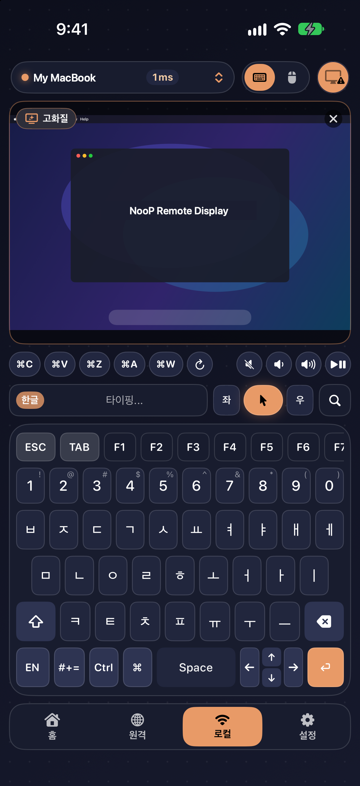
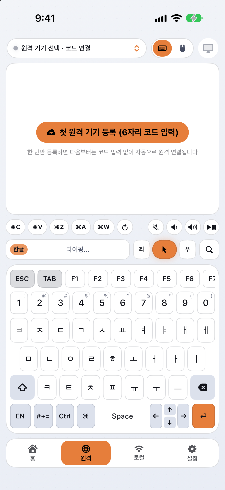
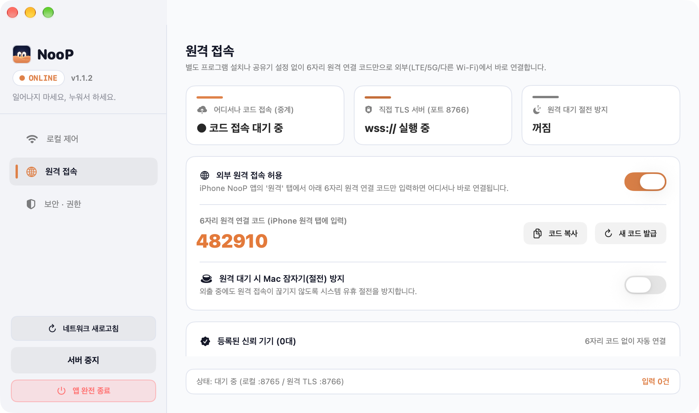
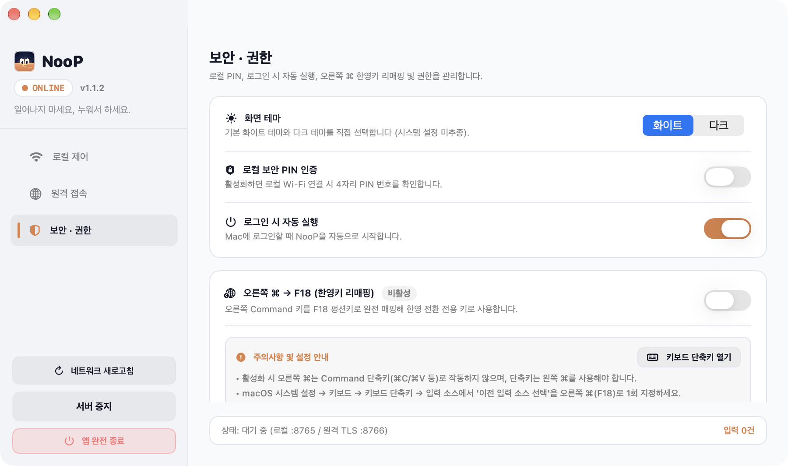

<h1>
  
  &nbsp;NooP
</h1>

> **일어나지 마세요, 누워서 하세요.**

iPhone을 **무선 마우스 · 키보드 · 원격 미니 모니터**로 사용하는 경량 로컬 + 원격 제어 앱입니다.  
같은 Wi-Fi에서는 자동으로 초고속 연결되며, Wi-Fi가 없을 때는 **Bluetooth LE**, 외부(LTE/5G/외부 Wi-Fi)에서는 별도 VPN이나 공유기 포트포워딩 없이 **6자리 원격 코드(1회성 연결 / 쌍방 영구 기기 등록)**로 즉시 연결됩니다.

> **다운로드 (Releases v1.1.2)**: [최신 버전 다운로드 바로가기](https://github.com/sungomi/NooP/releases/latest)  
> - **Mac (`NooP`)**: `NooP.dmg`  
> - **Windows (`NooP for pc`)**: `NooP-Setup.exe` *(Windows 10/11 64비트용 설치 파일)*  
> - **iPhone (`NooP`)**: **App Store 출시 예정** *(Coming Soon)*

---

## 기능별 화면 미리보기

### 1. 홈 허브 & 화이트 / 다크 테마
기본 **화이트 테마**와 눈이 편안한 **다크 테마**를 앱 내에서 직접 전환할 수 있습니다. 홈 화면에서 연결된 내 Mac/PC를 한눈에 확인하고 원터치로 전환합니다.

| 홈 허브 (`홈` · 기본 화이트) | 화면 공유 · 키보드 (`다크 테마`) | 설정 & 테마 전환 (`설정`) |
| :---: | :---: | :---: |
|  |  |  |

---

### 2. 로컬 제어 (화면 공유 · 키보드 · 트랙패드)
같은 Wi-Fi(Bonjour · UDP 자동 검색) 또는 Bluetooth LE로 지연 없이 연결됩니다.
- **키보드 모드**: 영문 QWERTY · 한글 두벌식 · 기호 · `F1~F12` · `⌘C/⌘V/⌘Z/⌘A/⌘W` · 미디어 컨트롤 · 중앙 **커서 핸들 & 좌/우 클릭**
- **트랙패드 모드**: 한 손가락 이동(속도 기반 가속), 탭 좌클릭, 두 손가락 스크롤 & 우클릭, **제스처 모드**(Mission Control · 공간 전환 · 핀치 줌)
- **Retina 실시간 화면 공유**: `초고화질 2560px` / `고화질 2200px` / `균형 1600px` / `절약 1280px` 실시간 화질 전환

| 화면 공유 + 키보드 (`로컬`) | 화면 공유 + 트랙패드 (`마우스`) |
| :---: | :---: |
|  |  |

#### 가로 전체화면 & 양손 분할(Split) 플로팅 키보드
화면을 터치해 우측 하단 **전체화면** 버튼을 누르면 가로 전체화면으로 전환되며, 우측 `키보드` 버튼으로 **양손 분할 플로팅 키보드**와 중앙 커서 핸들을 함께 사용할 수 있습니다.

  

---

### 3. 외부 원격 접속 (6자리 코드 · 1회성 연결 & 쌍방 영구 기기 등록)
별도 VPN이나 공유기 포트포워딩 없이 데스크톱 `NooP` 앱의 **6자리 원격 연결 코드**만으로 LTE/5G·외부 Wi-Fi 어디서나 접속할 수 있습니다.
- **영구 등록 연결 (쌍방 승인)**: Mac/PC에서 팝업 승인을 한 번 완료하면 전용 신뢰 채널이 발급되어, 이후에는 6자리 코드 없이 자동으로 즉시 연결됩니다.
- **1회성 연결 & 자동 재입력**: 임시로 다른 PC에 접속할 때는 1회성으로 연결하며, 연결 실패·만료 시 6자리 코드 재입력 창이 자동으로 표시됩니다.

| iPhone 원격 접속 (`원격`) | Mac `NooP` 원격 코드 & 신뢰 기기 관리 |
| :---: | :---: |
|  |  |

---

### 4. 데스크톱 에이전트 (`NooP` Mac / `NooP for pc` Windows)
로그인 시 자동 실행되며, 창 닫기(`X`) 시 메뉴 막대 / 시스템 트레이로 최소화되어 백그라운드에서 상시 대기합니다.
- **로컬 제어 대시보드**: 기기 이름(Bonjour), 로컬 IP, Bluetooth LE 상태 및 연결된 iPhone 실시간 모니터링
- **보안 · 권한 및 편의 기능**: 화이트/다크 테마 전환, 로컬 4자리 PIN 인증, 로그인 시 자동 실행, **오른쪽 `⌘` → `F18` 한영키 커널 리매핑**(Mac), 앱 완전 종료

| 로컬 제어 대시보드 (`NooP` Mac) | 보안 · 권한 & 오른쪽 ⌘ 한영키 리매핑 |
| :---: | :---: |
|  |  |

---

## 설치 방법

### 1. Mac / Windows 데스크톱 에이전트 설치하기
1. [Releases](https://github.com/sungomi/NooP/releases/latest)에서 OS에 맞는 파일(**`NooP.dmg`** 또는 **`NooP-Setup.exe`**)을 다운로드합니다.
2. **Mac 기준 (`NooP`)**:
   - `NooP.app`을 **`Applications(응용 프로그램)`** 폴더로 드래그합니다.
   - 처음 실행 시에는 **앱 아이콘 오른쪽 클릭 → `열기`**를 누릅니다. *(안 열리면 `시스템 설정` → `개인정보 보호 및 보안` → `확인 없이 열기`)*
   - 실행 후 **`손쉬운 사용`** 권한을 켜줍니다. *(화면 공유는 `화면 및 시스템 오디오 녹음` 권한도 허용)*
3. **Windows 기준 (`NooP for pc`)**:
   - **`NooP-Setup.exe`**를 실행하여 설치를 진행합니다. *(설치 과정에서 Windows 방화벽 허용 규칙 및 로그인 시 자동 실행이 함께 설정됩니다.)*
4. **외부 원격 접속**:
   - 데스크톱 앱 좌측 **`원격 접속`** 탭에 표시된 **6자리 숫자 코드**를 iPhone `NooP` 앱의 **`원격`** 탭에 입력해 **영구 등록 연결** 또는 **1회성 연결**로 바로 접속할 수 있습니다.

### 2. iPhone 앱 (`NooP`) 설치하기
- **App Store 출시 예정**입니다.
- 출시 후 앱을 설치하고 실행하면 **`로컬 네트워크`** 및 **`블루투스`** 권한을 허용한 뒤 로컬 또는 6자리 원격 코드로 바로 연결할 수 있습니다.

---

## 제작자

**sungomi** · [github.com/sungomi](https://github.com/sungomi)

© 2026 sungomi. All rights reserved. 자세한 내용은 [LICENSE](LICENSE)를 보세요.
