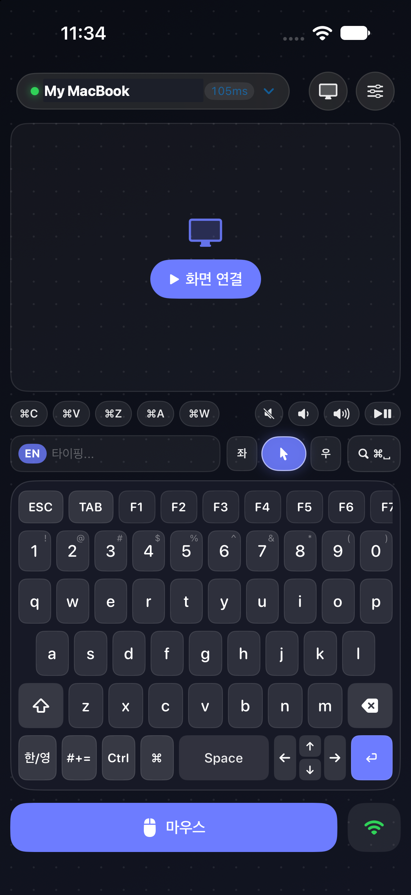

# AirPad

iPhone을 **무선 마우스 · 키보드 · 원격 미니 모니터**로 사용하는 경량 원격 제어 앱입니다.  
같은 Wi-Fi에서는 자동으로 초고속 연결되며, Wi-Fi가 없거나 차단된 환경에서는 **Bluetooth LE**로 자동 전환되어 동작합니다.

> **다운로드 (Releases)**: [최신 버전 다운로드 바로가기](https://github.com/sungomi/AirPad/releases/latest)  
> - **Mac**: `AirPadMac.dmg`  
> - **iPhone**: `AirPad.ipa` *(Sideloadly 설치용)*  
> - **Windows**: `AirPadPC.exe` *(추후 릴리스 업로드 예정)*

---

## 주요 기능

- **키보드 모드 우선 & 즉시 마우스 제어**
  - 영문 QWERTY · 한글 두벌식(쌍자음/조합 지원) · 기호 · `F1~F12` · `⌘C/⌘V/⌘Z/⌘A/⌘W` · `⌘Space` · 미디어 컨트롤
  - 중앙의 **커서 핸들**을 드래그하면 화면 전환 없이 바로 마우스를 움직이고, 양옆 `좌` / `우` 버튼으로 즉시 클릭 가능
- **트랙패드(마우스) 모드**
  - 한 손가락 이동(속도 기반 가속), 탭 좌클릭, 두 손가락 스크롤 & 탭 우클릭
  - 우측 상단 **제스처 모드** 버튼 활성화 시 한 손가락 스와이프(Mission Control / 데스크톱 공간 전환) 및 핀치 줌 지원
- **실시간 원격 화면 공유 & 전체화면 분할 키보드**
  - 상단 모니터 버튼(또는 `화면 연결`)을 누르면 Mac/PC 화면을 실시간으로 보면서 조작 가능
  - 화면을 터치해 우측 하단 **전체화면** 버튼을 누르면 가로 전체화면으로 전환되며, 상단 `키보드` 버튼으로 **양손 분할(Split) 플로팅 키보드** 사용 가능
- **Wi-Fi + Bluetooth LE 하이브리드 & 저전력 설계**
  - 한 번 연결해 두면 앱을 켤 때마다 자동 재연결, 백그라운드 전환 시 소켓·스캔 중단으로 배터리 소모 최소화

---

## 스크린샷

| iPhone 키보드 & 화면 창 | iPhone 트랙패드 | Mac 에이전트 |
| :---: | :---: | :---: |
|  |  |  |

---

## 설치 방법

### 1. Mac에 `AirPad Mac` 설치하기
1. [Releases](https://github.com/sungomi/AirPad/releases/latest)에서 **`AirPadMac.dmg`**를 다운로드해 엽니다.
2. `AirPadMac.app`을 **`Applications(응용 프로그램)`** 폴더로 드래그합니다.
3. 처음 실행할 때는 더블클릭 대신 **앱 아이콘 오른쪽 클릭 → `열기`**를 누릅니다.
   - *(안 열리면 `시스템 설정` → `개인정보 보호 및 보안` → 아래쪽 `확인 없이 열기` 클릭)*
4. 앱 실행 후 안내에 따라 **`손쉬운 사용`** 권한을 켜줍니다.
   - *(화면 공유 기능도 쓰려면 `화면 및 시스템 오디오 녹음` 권한도 함께 켜주세요.)*
5. Wi-Fi를 변경했을 때는 상단 **`↻` 새로고침 버튼**을 누르면 새 IP로 즉시 갱신됩니다.

### 2. iPhone에 `AirPad` 설치하기 (Sideloadly, 무료)
1. 컴퓨터에 무료 설치 도구 **Sideloadly**(`sideloadly.io`)를 설치하고, iPhone을 케이블로 연결합니다.
2. [Releases](https://github.com/sungomi/AirPad/releases/latest)에서 **`AirPad.ipa`**를 다운로드합니다.
3. Sideloadly에서 **Apple ID** 입력 → **IPA 아이콘 클릭해 `AirPad.ipa` 선택** → **`Start`** 클릭 후 계정 인증을 완료합니다.
4. 설치 후 iPhone에서 아래 2가지를 허용합니다:
   - **개발자 신뢰**: `설정` → `일반` → `VPN 및 기기 관리` → 본인 애플 계정 → **`신뢰`**
   - **개발자 모드**: `설정` → `개인정보 보호 및 보안` → **`개발자 모드`** 켜기 (재부팅 필요)
5. **`AirPad`** 앱 실행 후 **`로컬 네트워크`** 및 **`블루투스`** 권한을 모두 **`허용`**합니다.

*(참고: 무료 Apple 계정으로 설치한 앱은 7일마다 Sideloadly로 연장이 필요합니다.)*
